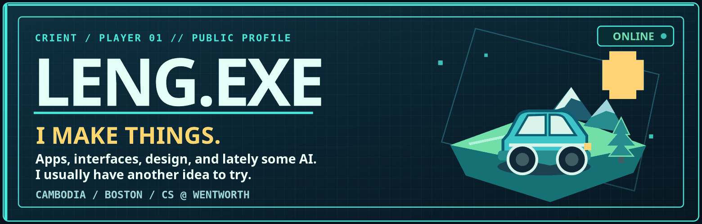
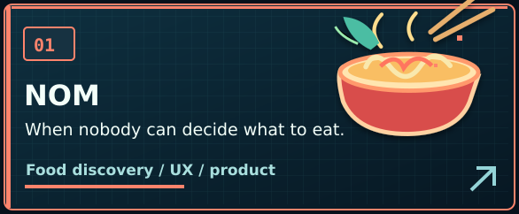
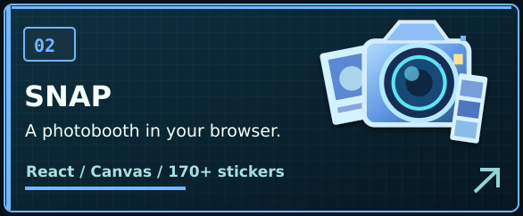
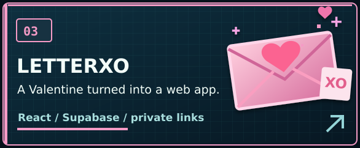
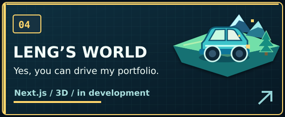
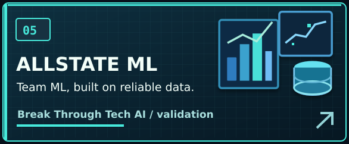
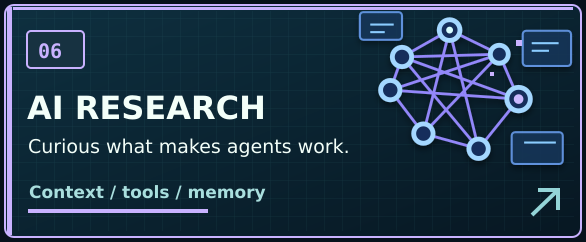
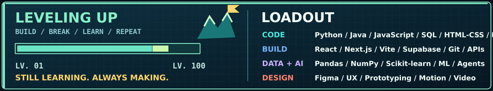

<!-- LENG.EXE V4 — individual clickable assets, cache-busted CTA and social images -->

  

Hey, I'm **Leng**. I'm from Cambodia and study Computer Science at Wentworth in Boston. I like building apps, designing interfaces, and figuring out how things work. Lately that's meant a food app, a photobooth, a portfolio you can drive through, and a lot of exploring AI agents.

  
  

### `01 / SELECT A PROJECT`

  
  
  
  
  
  

### `02 / LEVELING UP`

### `03 / FIND ME ELSEWHERE`

  
  
  
  

<!-- Your GitHub contribution calendar is already shown by GitHub under this README. -->
