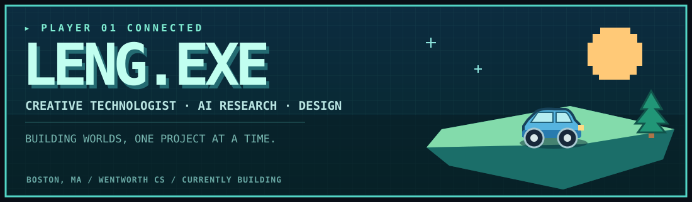
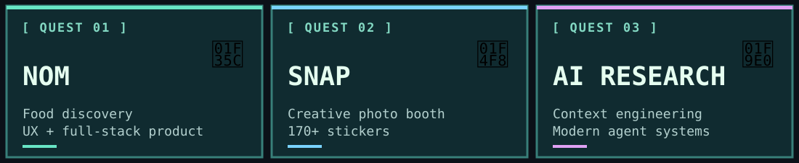
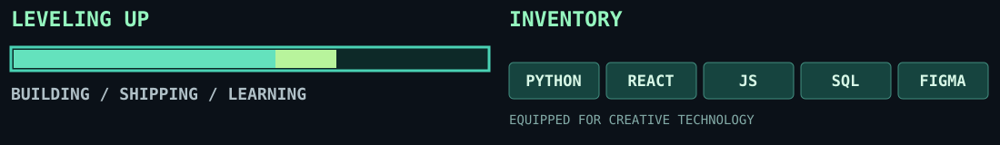

### `> SELECT QUEST`

| Quest | Mission | Explore |
|:--|:--|:--|
| `01` **Nom** | Food discovery through playful UX, region exploration, and personalization | [Source](https://github.com/Crient/nom) |
| `02` **SNAP** | Creative photo booth with 170+ stickers, customizable backgrounds, and local exports | [Live app](https://snapdigital.vercel.app) · [Source](https://github.com/Crient/SNAP) |
| `03` **AI Research** | Exploring context engineering and architectures for modern AI agents | *Research in progress* |
| `04` **LetterXO** | A shareable Valentine's experience backed by React and Supabase | [Source](https://github.com/Crient/LetterXO) |

### `> PLAYER BIO`

I'm **Leng**, a Computer Science student at **Wentworth Institute of Technology**, pursuing minors in **Data Science** and **Business Management**. I work across **AI research, product design, and creative software**, with a focus on making digital experiences useful and enjoyable.

- `CURRENT MISSION` — Context engineering and modern AI agent architectures.
- `BUILD MODE` — Interactive portfolio worlds, food discovery, and creative applications.
- `PREVIOUS QUEST` — Field Support co-op with Harvard University IT.
- `LOCATION` — Boston, Massachusetts.

### `> ACTIVITY MAP`

### `> CONNECT / SAVE GAME`

[LinkedIn](https://www.linkedin.com/in/gechlenglim/) · [Email](mailto:Crient01@gmail.com) · [Instagram](https://www.instagram.com/ffsleng/) · [TikTok](https://www.tiktok.com/@imreallyleng) · [Original portfolio file](https://drive.google.com/file/d/16DvE33bvEeuvKQP6S2mITKOdBAbgO5Hz/view)

Designed as a pixel-inspired GitHub README. Built with SVG and Markdown. Animations respect reduced-motion preferences.
