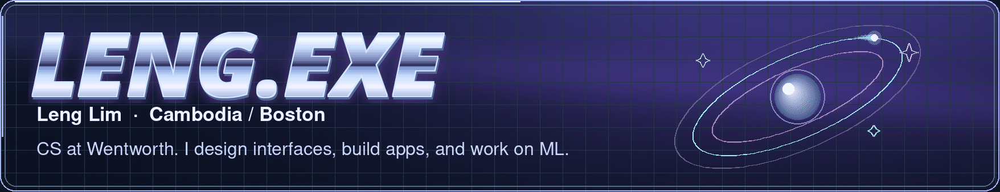
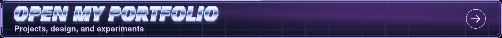
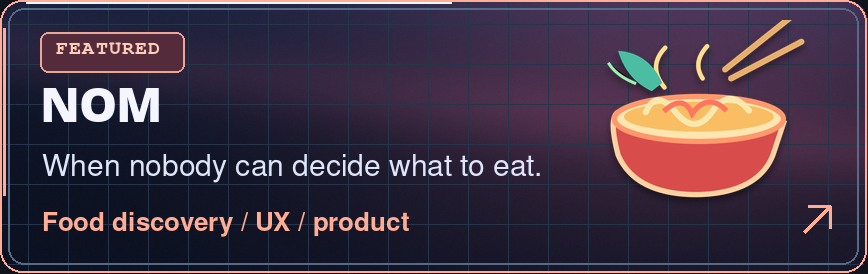
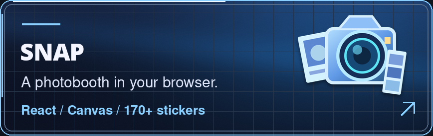
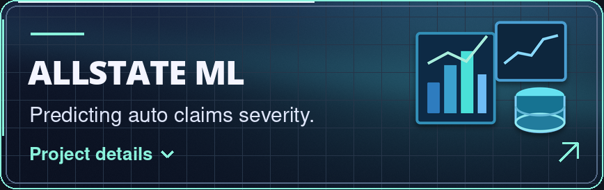
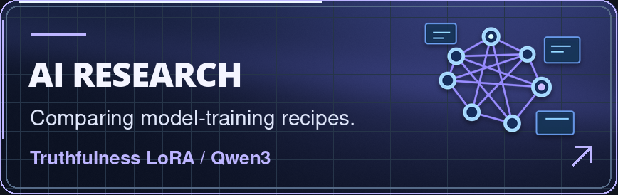
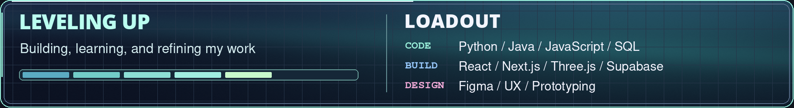

  

I'm pursuing **AI product management** and building projects in app design, machine learning, and AI research.

  
  

### `01 / SELECT A PROJECT`

  
  

  
  

  
  

Allstate project details

I worked on this project as a **Break Through Tech AI Studio Fellow**. Our team built regression models to estimate the final cost of auto insurance claims using 188,318 claims and 130 anonymized predictors. I validated the dataset, analyzed claim costs, and implemented an XGBoost workflow with five-fold cross-validation and fold-local preprocessing. The retained model achieved **1,167.52 validation MAE** in the original loss units.

[Team repository](https://github.com/Break-Through-Tech/Allstate-1C-predicting-auto-claims-severity) · [Data validation](https://github.com/Break-Through-Tech/Allstate-1C-predicting-auto-claims-severity/pull/20) · [XGBoost experiment](https://github.com/Break-Through-Tech/Allstate-1C-predicting-auto-claims-severity/pull/67)

### `02 / LEVELING UP`

### `03 / FIND ME ELSEWHERE`

  
  

  
  

[LinkedIn](https://www.linkedin.com/in/gechlenglim/) · [Crient01@gmail.com](mailto:Crient01@gmail.com)
